<div align="center">


<br>

**Odak oturumlarını, notları, planlamayı ve çalıştıkça büyüyen bir piksel bahçeyi tek uygulamada birleştiren Expo / React Native projesi.**

<br>


<sub>Arayüz etiketi: <code>LUMA-0.5.7-HOME-GREENHOUSE</code></sub>

<br><br>

<a href="#-uygulamada-neler-var">Özellikler</a> ·
<a href="#-hızlı-başlangıç">Hızlı başlangıç</a> ·
<a href="#-teknik-yapı">Teknik yapı</a> ·
<a href="#-rehberler">Rehberler</a> ·
<a href="#-test-jetonları-ve-kişisel-veriler">Kişisel veriler</a>

</div>


## 🌙 Kısa bir tur

<div align="center">
  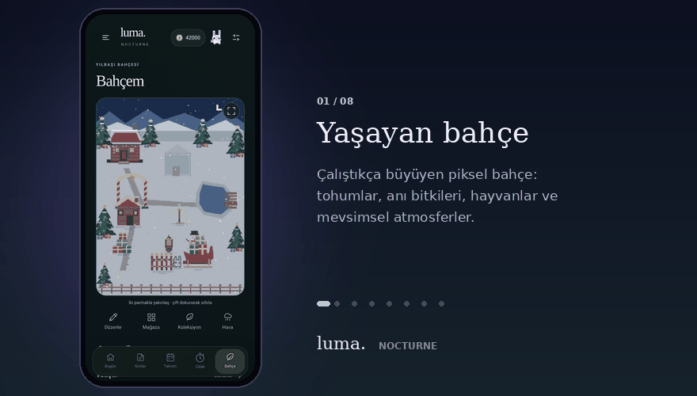
  <br>
  <sub>Ekranlardaki notlar, mobilyalar ve bakiyeler örnek kayıtlardır; uygulama başlangıçta satın alınmış öğe veya kişisel çalışma geçmişi içermez.</sub>
</div>


## ✨ Uygulamada neler var?

<table>
<tr>
<td width="50%" valign="top">

### ⏱️ Odak ve planlama
Çalışma yöntemleri, çalışma / mola ayarları, tam ekran sayaç, haftalık özet ve
çalışma sonunda **jeton ödülü**. Mola süresi çalışma kazancı üretmez.

</td>
<td width="50%" align="center">
</td>
</tr>
<tr>
<td valign="top">

### 📝 Notlar
Metin biçimlendirme, renkler, toplu seçim, çöp kutusu, kâğıt arka planları,
çizim alanı, tablo ve dosya ekleri. PDF görüntüleme ve işaretleme kaynakları da
bulunur.

</td>
<td valign="top">

### 🌸 Yaşayan bahçe
Tohum yetiştirme, anı bitkileri, hayvanlar, dekorlar, mevsimsel atmosferler ve
sınırları olan, iki parmakla yakınlaştırılabilen piksel sahne.

</td>
</tr>
<tr>
<td valign="top">

### 🏡 Ev ve kış bahçesi
Salon, mutfak, banyo, dinlenme odası, yatak odası ve camlı sera. Eşyalar alanlara
atanır; yön oklarıyla ya da **Düzenle** modunda sürüklenerek taşınır.

</td>
<td valign="top">

### 🛍️ Tematik mağazalar
Japon · Sakura, Çay & Kilim, Yılbaşı, Cadılar Bayramı ve Sera & Odalar
koleksiyonları. Bir eşyanın tek kopyası olur; odalar arasında taşınınca çoğalmaz.

</td>
</tr>
<tr>
<td colspan="2" valign="top">

### 🎹 Ses ve yedekleme
Katmanlı ortam sesleri, farklı ritim ve ölçülerde **özgün sentez piyano besteleri**,
dosya dışa / içe aktarma ve isteğe bağlı şifreli yedek akışı. Seslerin kaynak ve
lisans notları [`licenses/`](licenses/) klasöründedir. Sentez parçalar gerçek saha
veya akustik performans kaydı olarak sunulmaz.

</td>
</tr>
</table>

<details>
<summary><b>📸 Daha fazla ekran görüntüsü</b></summary>
<br>

| Kış bahçesi | Salon | Mutfak | Sakura bahçesi |
|:---:|:---:|:---:|:---:|
| 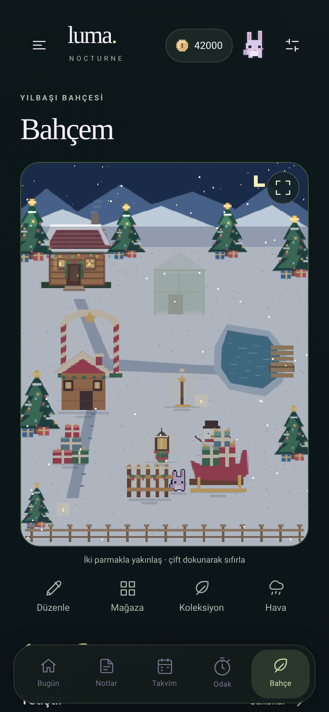 | 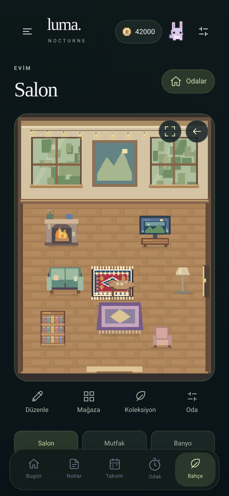 | 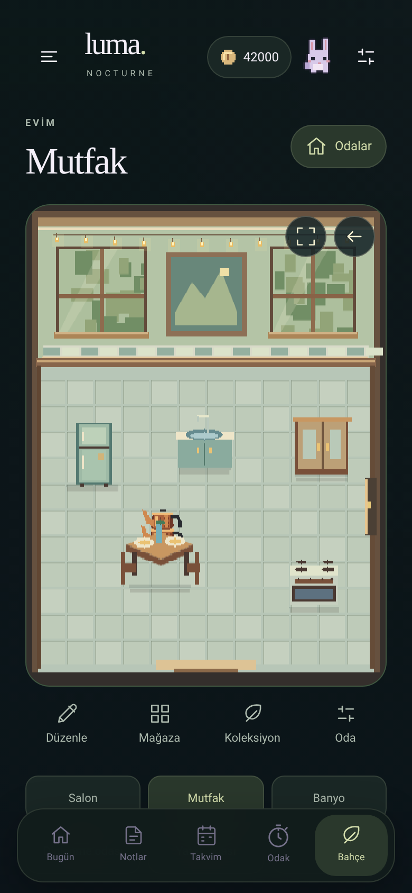 | 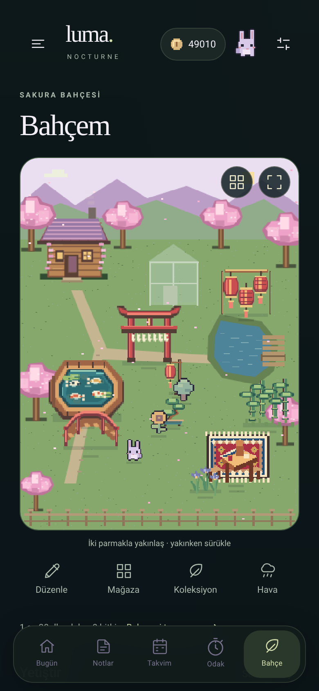 |
| **Odak** | **Notlar** | **Sesler** | **Sera** |
| 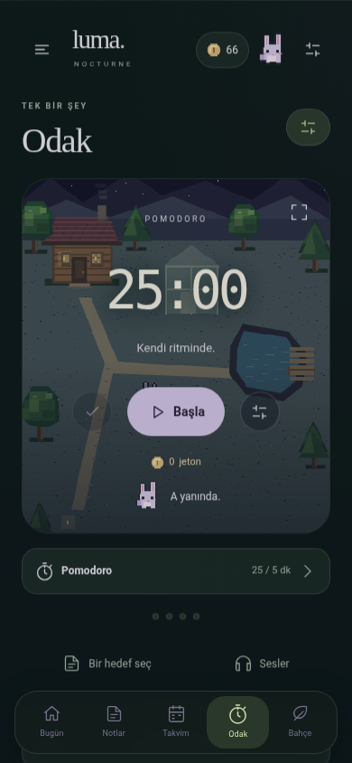 | 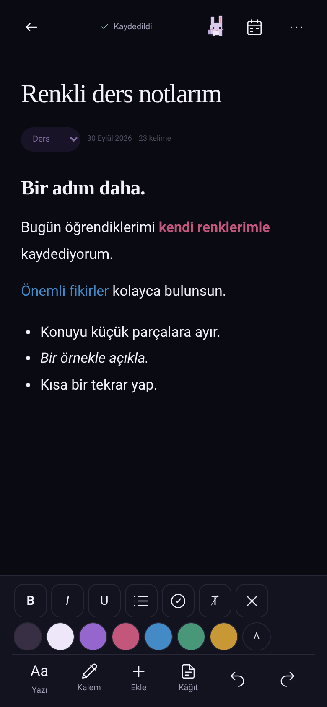 | 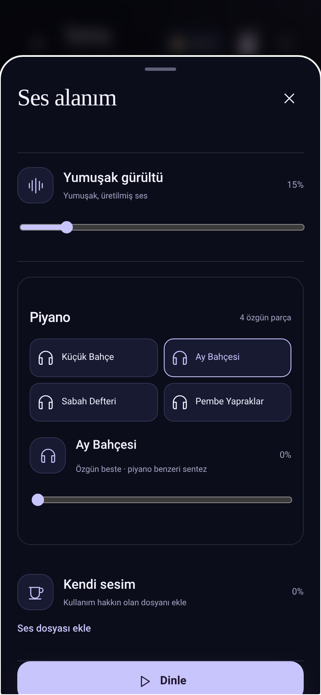 | 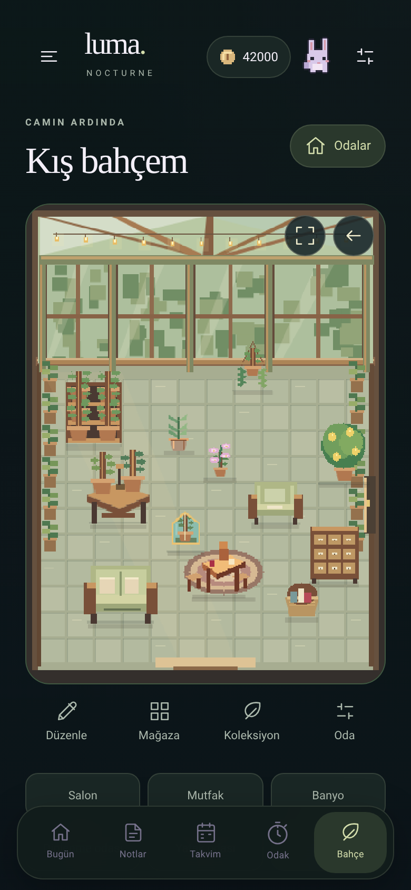 |

Genel bakış: [`docs/overview/uygulama.png`](docs/overview/uygulama.png)

</details>


## 🚀 Hızlı başlangıç

### 1 · Kurulum yapmadan kaynağı doğrula

Node kurulu bir Terminal'de, **bu klasörün içindeyken**:

```bash
node tools/verify.cjs
```

Bu kontrol npm paketlerini yüklemez; sürümü, başlangıç dosyalarını, üretilmiş
arayüzü, ses hash'lerini ve temel kaynak bütünlüğünü denetler. Gerçek iPhone testi değildir.

### 2 · Ayrı bir geliştirme kopyası olarak çalıştır

Proje `package.json` içinde **Node 24** ve **Expo 57** bağımlılıklarını tanımlar.
İlk kurulum internet erişimi ister; kurulu telefon projesinin yerine geçmez ve
telefon verilerini taşımaz.

```bash
npx --yes --package=node@24 --call 'node tools/setup.cjs'
```

`setup.cjs` npm paketlerini kurar, Expo 57 uyumunu kontrol eder, arayüzü yeniden
üretir ve Expo Go sunucusunu başlatır. Konsolda **bu klasörün tam yolunu** ve
`LUMA-0.5.7-HOME-GREENHOUSE` etiketini kontrol et. Hata olursa dur; eski klasörlerden
dosya kopyalayarak veya sürümleri rastgele değiştirerek devam etme.

### 3 · Kaynağı düzenledikten sonra

```bash
npm run build:ui   # tools/ui → nocturne/UI_HTML.ts + ONIZLEME.html
npm run verify     # kaynak bütünlüğü kontrolü
```

<details>
<summary><b>📦 Paket kilidi hakkında</b></summary>
<br>

Teslim edilen özgün 0.5.7 arşivinde `package-lock.json` yoktu; başka sürümün kilidi
kopyalanmadı veya doğrulanmamış bir kilit uydurulmadı. Başarılı ilk kurulumda oluşan
kilidi Git'e ekle. Bu nedenle mevcut Mac kurulumundaki kesin bağımlılık ağacının bu
arşivden birebir yeniden üretileceği garanti değildir. `npm ci` ancak geçerli bir kilit
dosyası oluştuktan sonra kullanılmalı.

Eski yerinde güncelleme yardımcıları (`*.command`, `tools/repair-existing.cjs`,
`README_TR.md`) geçmiş kaynak bütünlüğü için korunmuştur. Bu klasörü GitHub'da tutmak
için onları çalıştırman gerekmez; güncelleyiciyi eski `LumaNote_Nocturne_Final`
klasörüne rastgele uygulama.

</details>


## 🧩 Teknik yapı

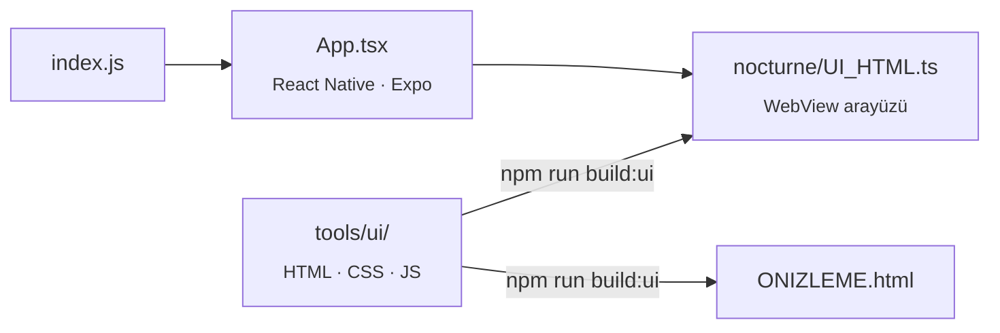

| Katman | Kullanılan yapı | Ana konum |
|---|---|---|
| Telefon uygulaması | TypeScript, React Native, Expo, WebView | `App.tsx`, `nocturne/` |
| Arayüz ve iş kuralları | HTML, CSS, JavaScript | `tools/ui/` |
| Piksel sahneler ve hareket | Canvas; lava temalarında WebGL ve yedek çizim | `tools/ui/` |
| Üretilmiş arayüz | Önizleme HTML'i ve WebView'in kullandığı TypeScript çıktısı | `ONIZLEME.html`, `nocturne/UI_HTML.ts` |
| Üretim ve doğrulama | Node.js / CommonJS | `tools/*.cjs` |
| Görsel / ses üreticileri ve tarihsel testler | Python, JavaScript | `tools/*.py`, `tests/` |

> [!IMPORTANT]
> Arayüz değişikliklerini **`tools/ui/`** içinde yap. `UI_HTML.ts` ve `ONIZLEME.html`
> aynı kaynaklardan üretilir; yalnızca birini elle düzenleme.

> [!NOTE]
> Dosya adında `v04`, `054`, `055` veya `056` bulunması onun gereksiz olduğu anlamına
> gelmez. Son sürüm bu birikimli modülleri de yükler; klasörleri isimlerine bakarak silme.


## 📚 Rehberler

| Amaç | Dosya |
|---|---|
| Uygulamayı ve kodu sıfırdan öğrenmek | [Görselli rehber — PDF](docs/rehber/LumaNote_Gorselli_Egitim_ve_Gelistirici_Rehberi.pdf) |
| Rehberi düzenlemek | [Görselli rehber — Word](docs/rehber/LumaNote_Gorselli_Egitim_ve_Gelistirici_Rehberi.docx) |
| Küçük örneklerle kod denemek | [Öğrenme atölyesi](examples/ogrenme-atolyesi/README.md) |
| Klasörü Terminal'den GitHub'a yüklemek | [GITHUBA_YUKLEME.md](GITHUBA_YUKLEME.md) |
| Paketin kaynağı, korunan dosyalar ve sınırlar | [Paket raporu](docs/GITHUB_PAKET_RAPORU.md) |
| 0.5.7 test kapsamı | [Özgün sürüm test raporu](docs/TEST_RAPORU_057.md) |
| Ses kaynakları ve lisanslar | [licenses/KAYNAKLAR.md](licenses/KAYNAKLAR.md) |


## 🪙 Test jetonları ve kişisel veriler

Bu kaynakta `LUMA_TEST_COINS_SWITCH = false`; 100.000.000 test jetonu otomatik verilmez.
Test cüzdanı ve kapatma / geçiş kodları korunmuştur, gerçek çalışma süresi uydurulmaz.
Depo telefondaki notları, bahçe yerleşimini veya test bakiyesini içermez.

> [!WARNING]
> Test jetonları açıkken oluşturulmuş bir yedeği, test anahtarı kapalı bu kopyada
> açarsan geçiş kodu test bütçesini ve testle alınmış öğeleri ayıklayabilir.
> Canlı verinin üzerinde yedeksiz test yapma ve kişisel kayıt yedeklerini depoya koyma.

## 🧭 Kapsam ve sınırlar

- Önceki test raporlarındaki rakamlar geçmiş çalıştırmalardır; bu pakette yeniden
  yapılmış telefon testleri olarak yorumlanmamalıdır.
- Fiziksel iPhone / Expo Go, yeni npm kurulumu, Metro iOS derlemesi, PDF uçtan uca
  akışı ve gerçek ses dinleme bu paketleme işinde yapılmadı.
- Arka planda / kilit ekranında sesin durması mevcut davranıştır.
- GitHub'a kaynak yüklemek App Store veya Google Play yayını değildir.

## 📄 Lisans

Projeye henüz bir açık kaynak lisansı atanmadı. Üçüncü taraf kaynak ve ses notları
[`licenses/`](licenses/) içinde korunur.

<br>

<div align="center">

<br>
<sub>🌙 <b>luma.</b> — her çalışma dakikası bir tohum.</sub>
</div>
